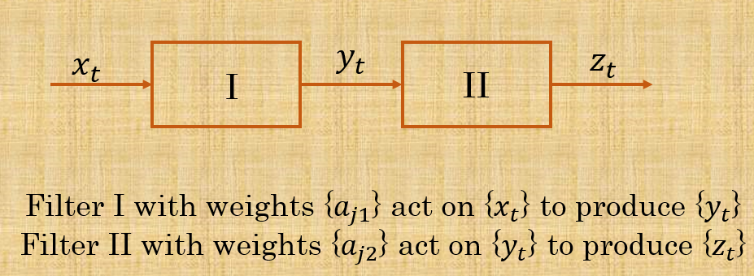

```{r setup, include=FALSE}
library(knitr)
library(readxl)
library(tidyverse)
library(shiny)
library(plotly)
library(grDevices)
library(ggthemes)
library(forecast)
library(DT)
library(rmarkdown)
library(rsconnect)

# writeManifest()
opts_chunk$set(echo = TRUE)

# Importing presentation data sets
## Textbook sales data Exercise 2.1
sales1 <- read_excel("salesData Ex2.1.xlsx", 
    sheet = "Problem 2.1")

sales1$week <- factor(x = sales1$week, 
                      levels = unique(sales1$week), labels = unique(sales1$week))

sales1.ts <- ts(sales1$sales, start = c(1967, 1), frequency = 13)

sales1.ts.decomposed <- decompose(sales1.ts) # Additive

sales1.ts.decomposed2 <- decompose(sales1.ts, type = "multiplicative") # Multiplicative

sales1$dates <- seq(as.Date("1967-01-28"), by = "4 weeks",
                    length.out = 52)

sales1 <- sales1 |> dplyr::relocate(dates, .after = year)

sales1$aseasonal <- sales1.ts.decomposed$seasonal # Additive

sales1$mseasonal <- sales1.ts.decomposed2$seasonal # Additive

sales1$trend <- sales1.ts.decomposed$trend # Trend

sales1$irr <- sales1.ts.decomposed$random # Irregular fluctuations

## Ahero dry maize price
maize <- read_excel("maize.xlsx")

maize$month <- factor(x = maize$month, levels = unique(maize$month),
                     labels = month.name)

maize$serial <- seq(1, length(maize$price_ksh), by = 1)

maize.ts <- ts(maize$price_ksh, start = c(2023, 1),
              frequency = 12)

maize$date <- seq(from = as.Date("2023-01-01"),
                 by = "month",
                 length.out = length(maize$price_ksh))

maize <- maize |> dplyr::relocate(date, .after = month)


## Ahero dry maize price
cane <- read_excel("cane.xlsx")

cane$month <- factor(x = cane$month, levels = unique(cane$month),
                     labels = month.name)

cane.ts <- ts(cane$metric_tonnes_000, start = c(2019, 1),
              frequency = 12)

cane$date <- seq(from = as.Date("2019-01-01"),
                 by = "month",
                 length.out = length(cane$metric_tonnes_000))

cane$serial <- seq(1, length(cane$metric_tonnes_000), by = 1)

cane <- cane |> dplyr::relocate(date, .after = month)


### Local Electricity consumption
consumption <- read_excel("local electricity consumption KPLC.xlsx", 
    sheet = "local power consumption")

consumption$month <- factor(x = consumption$month, levels = unique(consumption$month),
                     labels = month.name)

consumption.ts <- ts(consumption$amount, start = c(2019, 1),
              frequency = 12)

consumption$date <- seq(from = as.Date("2019-01-01"),
                 by = "month",
                 length.out = length(consumption$amount))

consumption <- consumption |> dplyr::relocate(date, .after = month)

## Mobile Payments
mobile <- read_excel("mobile.xlsx")


colnames(mobile) <- c("year", "month", "agents", "accounts_millions", "transaction_volume_millions", "transaction_value_billions")

mobile$serial <- 1:nrow(mobile)

volume.ts <- ts(mobile$transaction_volume_millions, 
                start = c(2007, 3),
                frequency = 12)
 
value.ts <- ts(mobile$transaction_value_billions, 
                start = c(2007, 3),
                frequency = 12)

agents.ts<- ts(mobile$agents,
               start = c(2007, 3),
               frequency = 12)

accounts.ts <- ts(mobile$accounts_millions,
                  start = c(2007, 3),
                  frequency = 12)

mobile$date <- seq(from = as.Date("2007-03-01"),
                 by = "month",
                 length.out = length(mobile$transaction_value_billions))


mobile <- mobile |> dplyr::relocate(date, .after = transaction_volume_millions)

```

## Table of Contents

- 2.1 Types of Variation
- 2.2 Stationary time series
- 2.3 The time plot
- 2.4 Transformations
- 2.5 Analyzing series which contain a trend
- 2.6 Analyzing series which contain seasonal variation
- 2.7 Autocorrelation
- 2.8 Other tests of randomness


# 2.1 Types of Variation

## 

This chapter introduces the descriptive methods applicable to any time series data.

The methods discussed here uncover the main properties of a given series and should be tried before attempting the sophisticated inferential methods.

Traditional methods of time-series are mainly concerned with **decomposing** the variation into **trend**, **seasonal variation**, **other cyclic changes** and the remaining **irregular fluctuations**. 

This approach is not always the best but it is valuable when when the variation is dominated by **trend** and/or **seasonality**

Different sources will now be described in detail.


## 2.1.1 Seasonal Variation

Numerous time series data such as **sales figures** and **temperature readings** exhibit variation which is annual in period. 
 
A good example is the sales performance of bookshop and uniform outlets in the country. 
The **highest** sales are typically recorded in the period of **December-January** then followed by the last weeks of **April** and **August**. 

This variation is easy to understand and it can be measured for further analysis and/or be removed for analysis of de-seasonalized data.

I use the following example obtained from [Exercise 2.1 pg. 25](https://docs.google.com/spreadsheets/d/1MuOyjepRkJtzNjgaJTbKBrThO4njMAeh/edit?usp=sharing&ouid=100299949886468366251&rtpof=true&sd=true) to visualise the seasonality variation often found in time series data.


## Seasonal Variation | Textbook sales data

```{r Textbook data seasonal, echo = FALSE}
tabsetPanel(
  id = "variationtab",
  tabPanel("Time Plot",
           plotlyOutput("textbooktimeplot1")),
  tabPanel("Additive Seasonal effect",
           plotlyOutput("textbookseasonal1")),
  tabPanel("Multiplicative Seasonal effect",
           plotlyOutput("textbookseasonal2"))
  )


output$textbooktimeplot1 <- renderPlotly({

  textbooktplot1 <- ggplot(data = sales1)+
  geom_line(aes(x = dates, y = sales))+
  labs(x = "Time", y = "Sales in USD",
       title = paste0("4-Week sales totals","\n",
                     "January 1967 - December 1970"))+
  theme_clean()

ggplotly(textbooktplot1)

})

output$textbookseasonal1 <- renderPlotly({
textbookseasonplot1 <- ggplot(data = sales1)+
  geom_line(aes(x = dates, y = aseasonal))+
  labs(x = "Time", y = "Sales in USD",
       title = paste0("4-Week sales: seasonal effects (Additive)","\n",
                     "January 1967 - December 1970"))+
  theme_clean()

ggplotly(textbookseasonplot1)
})

output$textbookseasonal2 <- renderPlotly({
textbookseasonplot2 <- ggplot(data = sales1)+
  geom_line(aes(x = dates, y = mseasonal))+
  labs(x = "Time", y = "Sales in USD",
       title = paste0("4-Week sales: seasonal effects (Multiplicative)","\n",
                     "January 1967 - December 1970"))+
  theme_clean()

ggplotly(textbookseasonplot2)
})
```


## 2.1.2 Trend Variation

The term **'trend'** may be defined as a **long-term change in the mean level**.

A difficulty with this definition is deciding what long-term actually is.

When speaking of a trend, we must take into account the **number of available observations** and make a  subjective assessment of what **long-term** is. 

## Trend Variation | Textbook sales data

```{r Textbook data trend, echo = FALSE}
tabsetPanel(
  id = "trendtab",
  tabPanel("Time Plot",
           plotlyOutput("textbooktimeplot2")),
  tabPanel("Trend",
           plotlyOutput("textbooktrend"))
  )

output$textbooktimeplot2 <- renderPlotly({
textbooktimeplot2 <- ggplot(data = sales1)+
  geom_line(aes(x = dates, y = sales))+
  labs(x = "Time", y = "Sales in USD",
       title = paste0("4-Week sales totals","\n",
                     "January 1967 - December 1970"))+
  theme_clean()

ggplotly(textbooktimeplot2)
  }
)

output$textbooktrend <- renderPlotly({
textbooktrendplot <- ggplot(data = sales1)+
  geom_line(aes(x = dates, y = trend))+
  labs(x = "Time", y = "Sales in USD",
       title = paste0("4-Week sales: Trend","\n",
                     "January 1967 - December 1970"))+
  theme_clean()

ggplotly(textbooktrendplot)
  }
)

```


## 2.1.3 Irregular fluctuations 

After the trend and cyclic variations have been removed from a set of data, we are left with a series of **residuals** which may or may not be random.

## Trend Variation | Textbook sales data

```{r Textbook data irregular, echo = FALSE}
tabsetPanel(
  id = "irregulartab",
  tabPanel("Time Plot",
           plotlyOutput("textbooktimeplot3")),
  tabPanel("Irregular fluctuation",
           plotlyOutput("textbookirregular"))
  )

output$textbooktimeplot3 <- renderPlotly({
textbooktimeplot3 <- ggplot(data = sales1)+
  geom_line(aes(x = dates, y = sales))+
  labs(x = "Time", y = "Sales in USD",
       title = paste0("4-Week sales totals","\n",
                     "January 1967 - December 1970"))+
  theme_clean()

ggplotly(textbooktimeplot3)
  }
)

output$textbookirregular <- renderPlotly({
textbookirregularplot <- ggplot(data = sales1)+
  geom_line(aes(x = dates, y = irr))+
  labs(x = "Time", y = "Sales in USD",
       title = paste0("4-Week sales: Irregular fluctuations","\n",
                     "January 1967 - December 1970"))+
  theme_clean()

ggplotly(textbookirregularplot)
  }
)
```


## 2.1.4 Other cyclic changes

Apart from seasonal effects, some time series exhibit variation at a fixed point due to some other physical cause. 

An example is daily variation temperature. 
In addition, some time series exhibit oscillations which do not have a fixed period but which are predictable to some extent.

For example, economic data are sometimes thought to be affected by business cycles with a period varying between about 5 to 7 years.


# 2.2 Stationary Time Series

##

A time series is said to be stationary if;

- there’s no systematic change in variance and
- Strictly periodic variations have been removed

A more Mathematical definition will be given in the subsequent chapter.

Most of the probability theory of time series analysis is concerned with **stationary** time series. 

For this reason, time series analysis often requires one to turn a **non-stationary** series into a **stationary** one so as to use this theory 


# 2.3 The Time Plot

## 

After getting the background information and carefully defining your objectives, the first and foremost important step in any time series analysis is to plot the observations against time.

The graph, shows very important features of the series such as **trends**, **seasonalities**, **outliers** and **discontinuities**.


## 

The usual rules for drawing **good** graphs should be followed;

- A clear title must be given
- Units of measurements should be stated
- Axes should be clearly stated

Today, graphs are often produced by computers. 

Some are well done, but other packages may produce rather poor graphs and the reader must be prepared to modify them if necessary. 

A graph is no good if the observer cannot interpret it upon observation.

The following slide shows some time plots I prepared alongside this presentation.

## The Time Plot | Visuals

```{r Time plot visuals, echo = FALSE}
tabsetPanel(
  id = "TimePlotVisuals",
  tabPanel("Time Plot I",
           plotlyOutput("tp1"),
           uiOutput("tp1Description")),
  tabPanel("Time Plot II",
           plotlyOutput("tp2"),
           uiOutput("tp2Description")),
  tabPanel("Time Plot III",
           plotlyOutput("tp3"),
           uiOutput("tp3Description")),
  tabPanel("Time Plot IV",
           plotlyOutput("tp4"),
           uiOutput("tp4Description"))
  )

output$tp1 <- renderPlotly({
  ahero <- ggplot(data = maize)+
             geom_line(aes(x = date, y = price_ksh),
                       colour = "#333333")+
             labs(x = "Time", y = "Price (Ksh.)",
             title = paste0("Average price of dry maize per Kg. in Ahero, Kisumu","\n",
                            "January 2023 - July 2026"))+
             theme_clean()
  
  ggplotly(ahero)
})

output$tp1Description <- renderUI({
  tags$a(href = 'https://docs.google.com/spreadsheets/d/137KTvL_ptVI8s7a448qPHe8_5EhN4UO4/edit?usp=sharing&ouid=100299949886468366251&rtpof=true&sd=true', "Download data"
  )
})

output$tp2 <- renderPlotly({
  sugar <- ggplot(data = cane)+
             geom_line(aes(x = date, y = metric_tonnes_000),
                       colour = "#660000")+
             labs(x = "Time", y = "Metric Tonnes ('000)",
             title = paste0("Cane deliveries in metric tonnes ('000)","\n",
                           "January 2019 - July 2026"))+
             theme_clean()
  
  ggplotly(sugar)
})

output$tp2Description <- renderUI({
  tags$a(href = 'https://docs.google.com/spreadsheets/d/137KTvL_ptVI8s7a448qPHe8_5EhN4UO4/edit?usp=sharing&ouid=100299949886468366251&rtpof=true&sd=true', "Download data"
  )
})

output$tp3 <- renderPlotly({
  local <- ggplot(data = consumption)+
             geom_line(aes(x = date, y = amount),
                       colour = "#336699")+
             labs(x = "Time", y = "Power in million KWh",
             title = paste0("Power consumption in Kenya (million KWh)","\n",
                            "January 2019 - July 2026"))+
             theme_clean()
  
  ggplotly(local)
})

output$tp3Description <- renderUI({
  tags$a(href = 'https://docs.google.com/spreadsheets/d/183LI6e12kjcKeyeYX7iC9PS5-BmEBi4rLEIT32XAdIU/edit?usp=drive_link', "Download data"
  )
})

output$tp4 <- renderPlotly({
  mpesa <- ggplot(data = mobile)+
             geom_line(aes(x = date, y = transaction_value_billions),
                       colour = "#006600")+
             labs(x = "Time", y = "Value in KSh. billion",
             title = paste0("Value of Total Agent Cash in Cash Out Mobile transactions (in billion Ksh.)", "\n", "March 2007 - August 2026"))+
             theme_clean()

  ggplotly(mpesa)
})


output$tp4Description <- renderUI({
  tags$a(href = 'https://docs.google.com/spreadsheets/d/1EvE1sMsyE3vA_sS3uSqd-bz4TlXtBXX6/edit?usp=sharing&ouid=100299949886468366251&rtpof=true&sd=true', "Download data"
  )
})
```

# 2.4 Transformations

##

Plotting data may suggest that it is sensible to consider transforming them, for example by taking **logarithms** or **square roots**.

The three main reasons for making a transformation are found in the following slides; 

## 2.4.1 To stabilize the variance

If there is a trend in the series and the variance appears to increase with the mean then it may be advisable to transform the data.

In particular, if the **standard deviation** is directly proportional to the **mean**, a **logarithmic transformation** is indicated.

## 2.4.2 To make the seasonal effect additive

If there is a trend in the series and the size of the seasonal effect appears to increase with the mean, then it may be advisable to transform the data so as to make the seasonal effect constant from year to year.

In this case the seasonal effect is said to be **additive**

In particular, the size of the seasonal effect is said to be **multiplicative**, if it is directly proportional to the mean.

For this case, we apply a logarithmic transformation to make the seasonal effect additive.
This transformation is **effective**(stabilizes the variance) if the error term is also multiplicative. 


## 2.4.3 To make the data Normally distributed

Model building and forecasting are usually carried out on the assumption that the data are **normally distributed**.

The logarithm and square root transformations are special cases of the class of transformations called the **Box-Cox transformations**.

Given an observed time series \( \{ {x}_{t} \} \) and a transformation parameter \( \lambda \), the transformed series is given by 

\[ {y}_{t} = \begin{cases}
              \frac{({x_t}^{\lambda}-1)}{\lambda},\ \lambda \neq 0 \\
              \log {x_t},\ \lambda = 0
             \end{cases}
\]


## To make the data Normally distributed | continued

Nelson & Granger found **little** improvement in forecast performance when a general Box-Cox transform was applied to a number of series.

In any case, a model constructed for the transformed data may be less than helpful.
For example, forecasts produced by the transformed model may have to be transformed back in order to be of use and this can introduce **biasing effects**.

The author’s personal preference is to **avoid transformations** wherever possible except where the transformed variable has a direct physical interpretation.

## To make the data Normally distributed | Power Consumption example 

```{r Power Consumption transform example, echo = FALSE}
# Power consumption data transformation example
## Box-Cox lambda estimate [Guerrero's method]
consumption.lambda <- BoxCox.lambda(consumption$amount) 

# Box-Cox transformed Power consumption amount 
consumption$bc <- BoxCox(consumption$amount, lambda = consumption.lambda)

tabsetPanel(id = "ComsumptionTransform",
            tabPanel("Original Series",
                     plotlyOutput("OriginalConsumption")),
            tabPanel("Transformed Series",
                     plotlyOutput("TransformedConsumption"))
            )

output$OriginalConsumption <- renderPlotly({
  originalconsumptionplot <- ggplot(data = consumption)+
                    geom_line(aes(x = date, y = amount), colour = "#336699")+
                    labs(x = "Time", y = "Power in million KWh",
                      title = paste0("Power consumption in Kenya (million KWh)","\n",
                            "January 2019 - July 2026"))+
                    theme_clean()
  
  ggplotly(originalconsumptionplot)
})

output$TransformedConsumption <- renderPlotly({
  transformedconsumptionplot <- ggplot(data = consumption)+
                    geom_line(aes(x = date, y = bc), colour = "#336699")+
                    labs(x = "Time", y = "Transformed Power KWh",
                      title = paste0("Box-Cox transformed power consumption in Kenya","\n",
                            "January 2019 - July 2026 [", "\u03bb", "=",round(consumption.lambda,4),"]"))+
                    theme_clean()
  
  ggplotly(transformedconsumptionplot)
})

```

# 2.5 Analysing series which contain a trend

##

In the previous section we loosely defined a trend as a **long term change in the mean level**.

The simplest trend is the familiar **linear trend + noise**, for which the observations at time, \( t \) is a random variable \( {x}_{t} \) given by \( {x}_{t} = \alpha + \beta t + {\varepsilon}_{t} \)
where \( \alpha \), \( \beta \) are constants and \( {\varepsilon}_{t} \) denotes a random error term with **zero mean** 


## 

The analysis of time series which exhibits a trend depends on whether one wants to do the following;

i. Measure the trend and/or;
ii. Remove the trend in order to analyze local fluctuations

In addition, the analysis of a time series which has a trend is also dependent on whether the same series exhibits **seasonality**

Now with seasonal data at hand, it is a good idea to start by calculating **successive yearly averages** as these will provide a simple description of the underlying trend.

An approach of this type is adequate when the trend is **small**,  but sometimes more sophisticated techniques will be desired and the following methods will be called into action.   


## 2.5.1 Curve fitting

A traditional method of dealing with non-seasonal data which contains a trend, particularly yearly data is to fit a simple function such as a **polynomial curve** (linear or quadratic) or a **Gompertz Curve**

We shall fit the following trend lines to the available data sets  

- linear trend line (Cane deliveries)
- quadratic trend line (Ahero maize price)
- Gompertz curve (Registered mobile money accounts)

## Curve fitting | Linear trend (Cane deliveries)

```{r CurvefittingLinearTrend, echo = FALSE}
tabsetPanel(id = "lineartrend",
            tabPanel("Table",
                     DTOutput("lineartrendtable")),
            tabPanel("Plot",
                     plotlyOutput("lineartrendplot"))
          )

# Cane deliveries linear model
cane.model1 <- lm(metric_tonnes_000 ~ serial, data = cane)

# Cane deliveries fitted values
cane$linear.fit <- round(cane.model1$fitted.values, 2)

output$lineartrendtable <- renderDT({
  cane |> 
    select(year, month, metric_tonnes_000, linear.fit) |> 
    tail(5) |> 
    datatable(class = "display", style = "bootstrap",
              colnames = c("Year", "Month", "Tonnes delivered (actual)",
                                              "Tonnes delivered (linear fit)"))
})

output$lineartrendplot <- renderPlotly({
  linearfitplot <- ggplot(data = cane, aes(x = date))+
                    geom_line(aes(y = metric_tonnes_000), colour = "#660000")+
                    geom_point(aes(y = metric_tonnes_000), colour = "#660000")+
                    geom_line(aes(y = linear.fit), colour = "#336699")+
                    annotate(geom = "text", x = as.Date("2020-04-01"), y = 800, label = paste0("metric tonne = ",round(cane.model1$coefficients[1],2)," + ",round(cane.model1$coefficients[2],2)," time"))+
                    labs(title = paste0("Linear trend of cane deliveries in '000 metric tonnes", "\n", "January 2019 - July 2026"),
                         x = "Time", y = "Metric tonnes (in '000)")+
                    theme_clean()
ggplotly(linearfitplot)
})
```

## Curve fitting | Quadratic trend (Ahero maize price)

```{r CurvefittingQuadraticTrend, echo = FALSE}
tabsetPanel(id = "quadtrend",
            tabPanel("Table",
                     DTOutput("quadtrendtable")),
            tabPanel("Plot",
                     plotlyOutput("quadtrendplot"))
          )


# Cane deliveries quadratic model
maize.model1 <- lm(maize$price_ksh ~ serial + I(serial^2), data = maize)

# Cane deliveries fitted values
maize$quad.fit <- round(maize.model1$fitted.values, 2)

output$quadtrendtable <- renderDT({
  maize |> 
    select(year, month, price_ksh, quad.fit) |> 
    tail(5) |> 
    datatable(class = "display", style = "bootstrap",
              colnames = c("Year", "Month", "Price per Kilogram in Ksh. (actual)",
                                              "Price per Kilogram in Ksh. (fitted)"))
})

output$quadtrendplot <- renderPlotly({
  quadfitplot <- ggplot(data = maize, aes(x = date))+
                    geom_line(aes(y = price_ksh), colour = "#333333")+
                    geom_point(aes(y = price_ksh), colour = "#333333")+
                    geom_line(aes(y = quad.fit), colour = "#336699")+
                    annotate(geom = "text", x = as.Date("2024-06-01"), y = 82, label = paste0("price = ", round(maize.model1$coefficients[1],2)," ",  round(maize.model1$coefficients[2],2)," time", " + ", round(maize.model1$coefficients[3],2), HTML(" time<sup>2</sup>")))+
                    labs(title = paste0("Quadratic trend of Dry maize per Kilo in Ahero - Kisumu", "\n", "January 2023 - July 2026"),
                         x = "Time", y = "Price in Ksh.")+
                    theme_clean()
ggplotly(quadfitplot)
})
```


## Curve fitting | Gompertz curve (Registered mobile money accounts)

```{r GompertzCurve, echo = FALSE}
# Mobile money accounts Gompertz curve fitting
accounts.model1 <- nls(
  accounts_millions ~ SSgompertz(serial, Asym, b2, b3), data = mobile)

# Mobile money accounts fitted values
mobile$gompertz.fit <- predict(accounts.model1) |> round(2)


tabsetPanel(id = "gompertztrend",
            tabPanel("Table",
                     dataTableOutput("gompertztable")),
            tabPanel("Plot",
                     plotlyOutput("gompertzcurveplot"))
          )

output$gompertztable <- renderDataTable({
  mobile |> 
    select(year, month, accounts_millions, gompertz.fit) |> 
    tail(5) |> 
    datatable(class = "display", style = "bootstrap",
              colnames = c("Year", "Month", "Registered accounts in millions (actual)",
                                              "Registered accounts in millions (fitted)")) 
})


# Gompertz Equation
## Gompertz coefficients
gompertz.params <- coef(accounts.model1)
asym <- gompertz.params[1] |> round(2)
gompertz.b <- gompertz.params[2] |> round(2)
gompertz.c <- gompertz.params[3] |> round(2)

output$gompertzcurveplot <- renderPlotly({
  gompertzplot <- ggplot(data = mobile, aes(x = date))+
                    geom_point(
                      aes(y = accounts_millions), 
                      colour = "#333333", shape = 4) +
                    geom_line(
                      aes(y = gompertz.fit), 
                      colour = "#336699") +
                    labs(title = paste0(
                        "Total Registered mobile money accounts (in millions)","\n",
                        "March 2007 - August 2026"),
                         x = "Time", y = "Registered accounts in millions")+
                    theme_clean()

  
  ggplotly(gompertzplot)
})
```


## 2.5.2 Filtering

A second procedure for dealing with a trend is to use a **linear filter** which converts one time series \( {x}_{t} \) to another \( {y}_{t} \), by the linear operation

\[ {y}_{t} = \sum_{r=-q}^{+s} {a_r}{x}_{t+r} \]
\[ \text{where }\{a_r\} \text{ is a set of weights} \]
In order to **smooth out local fluctuations** and estimate the **local mean**, we should clearly choose the weights so that \( \sum {a_r} = 1 \).

This operation is often referred to as a **moving average**. Moving averages are often **symmetric** in nature. We shall have a look at some examples of linear filters.

## Filtering | Symmetric - equally assigned moving averages (Power consumption)

```{r Symmetric3PointMA, echo = FALSE}
# Calculating the 3 point MA
consumption$three.pa <- stats::filter(consumption$amount,
                                      filter = rep(1/3, 3), 
                                      sides = 2) |> c()

# Calculating the 5 point MA
consumption$five.pa <- stats::filter(consumption$amount,
                                      filter = rep(1/5, 5), 
                                      sides = 2) |> c()

tabsetPanel(id = "Filtering1",
            tabPanel("3-point",
                     plotlyOutput("threepoint")),
            tabPanel("5-point",
                     plotlyOutput("fivepoint")))

output$threepoint<- renderPlotly({
  threepointplot <- ggplot(data = consumption, aes(x = date))+
                      geom_line(aes(y = amount), colour = "#CC9933")+
                      geom_line(aes(y = three.pa), colour = "#000066")+
                      geom_point(aes(y = amount), colour = "#CC9933")+
                      labs(
                        title = paste0("Power consumption in Kenya (million KWh) with 3-point moving average","\n","January 2019 - July 2026"),
                        x = "Time", y = "Power in million KWh")+
                      theme_clean()
    
  ggplotly(threepointplot)    
})


output$fivepoint <- renderPlotly({
  fivepointplot <- ggplot(data = consumption, aes(x = date))+
                      geom_line(aes(y = amount), colour = "#CC9933")+
                      geom_line(aes(y = five.pa), colour = "#000066")+
                      geom_point(aes(y = amount), colour = "#CC9933")+
                      labs(
                        title = paste0("Power consumption in Kenya (million KWh) with 5-point moving average","\n","January 2019 - July 2026"),
                        x = "Time", y = "Power in million KWh")+
                      theme_clean()
    
  ggplotly(fivepointplot)    
})

```

## Filtering | Symmetric - Gaussian assigned moving averages (Cane deliveries)

```{r CaneGaussianMAs, echo = FALSE}
fluidPage(
  sidebarLayout(
    titlePanel(""),
      sidebarPanel(
        sliderInput("rwID", "Distance from central point",
                    min = 3, max = 15, value = 5, step = 2),
        sliderInput("sigmaID", label = paste0("Sigma - ","\u03C3"), 
                    min = 0.5, max = 10, value = 2, step = 0.5), width = 3),
      mainPanel(plotlyOutput("gaussianma"))
    
  )
)


output$gaussianma <- renderPlotly({

  # Create a time radius
  time.r <- input$rwID
  
  # Create a time diameter
  time.d <- seq(-time.r, time.r, by = 1)
  
  # Gaussian weights
  ## Standard deviation of Gaussian weights
  g.sigma <- input$sigmaID
  
  ## Raw weights
  raw.g.weights <- exp(-(time.d^2)/2*(g.sigma^2))
  final.g.weights <- raw.g.weights/sum(raw.g.weights)

  # Computing the weights for the cane deliveries
  cane$g.smooth <- stats::filter(cane$metric_tonnes_000, filter = final.g.weights,
                                  method = "convolution", sides = 2)
  
  gaussiantimeplot <- ggplot(data = cane, aes(x = date))+
                        geom_line(aes(y = metric_tonnes_000), colour = "#CC9933")+
                        geom_point(aes(y = metric_tonnes_000), colour = "#CC9933")+
                        geom_line(aes(y = g.smooth), colour = "#000066")+
                        labs(
                          title = paste0("Cane deliveries in '000 metric tonnes","\n" ,"with a ", time.r,"- point Gaussian moving average January 2019 - July 2026"),
                          x = "Time", y = "Amount in '000 metric tonnes")+
                        theme_clean()
  
  ggplotly(gaussiantimeplot)                      
  })


```

## Filtering | Asymmetrical weights through Exponential smoothing
<!-- - The asymmetrical weights (Exponential Smoothing) -->
```{r ExponentialSmoothing, echo = FALSE}
tabsetPanel(id = "ExponentialSmoothingpage",
            tabPanel("Introduction",
                     uiOutput("exponentialsmoothingnotes")),
            tabPanel("Plot",
                     plotlyOutput("expsmplot")))

output$exponentialsmoothingnotes <- renderUI({
  HTML("<p> Whenever a symmetrical filter is chosen, there is likely to be an ",
         HTML(paste0("<b>end-effects</b>")), " problem.",
         HTML(paste0("</br>")),
         "This is because the new smoothed values do not cover the initial and final observations recorded at those times.", "\n",
         "We counter this by using an ", HTML(paste0("<b>asymmetric filter</b>")), " which involves only present and past values of the initial time series. </p>")
})

# Exponential model
value.model1 <- HoltWinters(x = mobile$transaction_value_billions,
           beta = FALSE, gamma = FALSE)

# Exponential smoothed series for mobile Transaction data
mobile$exp.smooth <- c(mobile$transaction_value_billions[1], value.model1$fitted[,2])

output$expsmplot <- renderPlotly({
  expsmoothingplot <- ggplot(data = mobile, aes(x = date))+
                        geom_point(aes(y = transaction_value_billions), 
                                   colour = "#CC9933")+
                        geom_line(aes(y = transaction_value_billions), 
                                   colour = "#CC9933")+
                        geom_line(aes(y = exp.smooth), colour = "#000066")+
                        labs(
                          title = paste0(
                            "Value of cash in cash out mobile transactions in billion Ksh. with Exponential smoothed values","\n","March 2007 - August 2026 [", "\u03b1"," = ", round(value.model1$alpha,4), " ]") ,
                          x = "Time", y = "Transaction value in billion Ksh.")+
                          theme_clean()
   ggplotly(expsmoothingplot)                       
})
```


## Filtering | Choosing the right filter

How do we choose the right filter?

The answer to this question really requires **considerable experience** plus a knowledge of the **frequence aspects** (Analysis of time series in the frequency domain) which will be discussed in the subsequent chapters

## Filtering | Filters in series

Very often a smoothing procedure is carried out in **two** or **more** stages, so that one has in effect several **linear filters in series**

```{r, echo=FALSE, out.width="75%", fig.align="center", fig.cap=""}



```

## Filtering | Filters in series (continued)

Now, the combination of both operations to make a **linear filter** \( \{{c}_{j}\} \) is formally known as a **convolution**.

We can represent it as;
\[ \{c_j\} =\{a_{r1}\}∗\{a_{r2}\} \]


## 2.5.3 Differencing

This is a special kind of filtering, which is useful for removing a **trend** from a time series until it becomes **stationary**.

This is an integral method advocated by Box & Jenkins (1970)

For **non-seasonal data**, first order differencing is sufficient to attain **apparent stationarity**, such that the new series, \( \{ {y}_{1},{y}_{2},…, {y}_{N-1}\} \) is formed from the original series \( \{ {x}_{1},{x}_{2},…, {x}_{N}\} \) by;

\[ {y}_{t}  = {x}_{t} - {x}_{t-1} = \nabla {x}_{t} \]

Second order differencing is given by;
\[ {\nabla}^{2} {x}_{t} = \nabla {x}_{t} − \nabla {x}_{t-2} \]
\[ {\nabla}^{2} {x}_{t} = {x}_{t} - 2{x}_{t-1} + {x}_{t-2} \] 


# 2.6 Analysing series which contain seasonal variation  

## 

In examining seasonality in time series, three models in common use are;
\[ \mathbf{A:}\ {x}_{t} = {m}_{t}+{S}_{t} + {\varepsilon}_{t} \]
\[ \mathbf{B:}\ {x}_{t} = {m}_{t}{S}_{t} + {\varepsilon}_{t} \]
\[ \mathbf{C:}\ {x}_{t} = {m}_{t}{S}_{t}{\varepsilon}_{t} \]

\[ \text{where} \]

- \( {m}_{t} \) is the deseasonalised mean level at time t

- \( {S}_{t}\) is the seasonal effect at time t

- \( {\varepsilon}_{t}\) is the random error at time t

For model C, a **logarithmic transformation** turns it to **linear (additive) model**, which is easier to handle

## 

A **trend** can appear in seasonal time series data.

For series showing **little trend**, it is usually adequate to estimate the seasonal effect for a particular period (say January observations) by finding the average of each January observation minus the corresponding yearly average for the **additive seasonality** case.

For the **multiplicative case**, take the January observation and divide it by the yearly average

For series with a **significant trend**, a more sophisticated approach may be required. 

Given monthly data, we calculate a smoothed series using;
\[  Sm({x}_{t}) = \frac{\frac{{x}_{t-6}}{2}+{x}_{t-5}+...+{x}_{t+5}+\frac{{x}_{t+6}}{2}}{12} \]

Notice that the sum of the coefficients equal \( 1 \)

## 

Seasonal effects can also be removed by **differencing**.

For example, monthly data can employ the operator;

\[ {\nabla}_{12} {x}_{t} = {x}_{t} − {x}_{t-12} \]


# 2.7 Autocorrelation

## 

An important guide to the properties of a time series is provided by a series of quantities called **sample autocorrelation coefficients**, which measure the correlation between the observations at different distances apart.

These coefficients provide insights into the **probability model** which generated the data.

The author assumes that the reader has knowledge on calculating the **Pearson’s correlation coefficient, r**


## 

Given \( N \) observations of a discrete time series, we form \( N-1 \) pairs of observations, namely \( ({x}_{1},{x}_{2}) \), \( (x_2, x_3) \), …,\( ({x}_{N-1}, {x}_{N})\) 
We shall regard the **first observation** in each pair as one variable, and the **second observation** as the second observation. We have the correlation coefficient between \( x_t\) and \( {x}_{t+1} \) given by;

\[ {r}_{1} = \frac{\sum_{t=1}^{N-1}({x}_{t}-{\bar{x}}_{(1)})({x}_{t+1}-{\bar{x}}_{(2)})}{\sqrt{\sum_{t=1}^{N-1}{({x}_{t}-{\bar{x}}_{(1)})}^{2}\sum_{t=1}^{N-1}{({x}_{t+1}-{\bar{x}}_{(2)})}^{2}}}\text{ ... (2.7.1)} \]


## 

\[ \text{where} \]
\[ {\bar{x}}_{(1)} = \frac{1}{N-1} \sum_{t=1}^{N-1} {x}_{t} \text{ is the mean of the first N-1 observations} \]
\[ {\bar{x}}_{(2)} = \frac{1}{N-1} \sum_{t=2}^{N} {x}_{t} \text{ is the mean of the last N-1 observations} \]


## 

**Equation 2.7.1** is rather complicated.  We shall therefore, take advantage of the fact that \( {\bar{x}}_{(1)} \cong {\bar{x}}_{(2)} \) and use the simpler formula below;

\[ {r}_{1} = \frac{\sum_{t=1}^{N-1}(x_t-\bar{x})({x}_{t+1}-\bar{x})}{\sum_{t=1}^{N}{{(x_t-\bar{x})}^{2}}} \text{ ...(2.7.2)} \] 

In a similar way, we can find the correlation between observations, a distance \( k \) apart through 
\[ {r}_{k} = \frac{\sum_{t=1}^{N-k}(x_t-\bar{x})({x}_{t+k}-\bar{x})}{\sum_{t=1}^{N}{{(x_t-\bar{x})}^{2}}} \text{ ...(2.7.3)} \] 

Now **Equation 2.7.3** is the autocorrelation coefficient at lag \( k \)


## 2.7.1 The Correlogram

This is a useful aid analysts use in interpreting a set of autocorrelation coefficients where a set of \( {r}_{k}s \) are plotted against their respective lag differences at points \( k \).

A visual inspection of the correlogram is often very helpful.


## 2.7.2 Interpreting the correlogram
Interpreting the meaning of a set of autocorrelation coefficients is not always easy.
Here the author offers some **general advice** in regards to the following series;

- Non-stationary series
- Short-term correlation
- Outliers
- General Remarks

## Interpreting the correlogram | continued {.smaller}

```{r CorrelogramInterpretation, echo = FALSE}
# Simulated stationary AR(1) series
set.seed(254) 
  ss <- data.frame(
    y = arima.sim(n = 91, model = list(ar = 0.56)) |> c(),
    x = consumption$date
  )
  
# Subsetting consumption time series
consumption.outlier <- consumption
  
# Outlier insertion at time 16 (April 2026)
consumption.outlier$amount[88] <- 123 


fluidPage(
  sidebarLayout(
      sidebarPanel(
        selectInput("seriesID", "Select type of series",
                    choices = c("Non-stationary\nseries" = "nonstationary", 
                                "Stationary\nseries" = "stationary",
                                "With\noutliers" = "outliers", 
                                "General" = "general"))
        , width = 3),
      mainPanel(
        tabsetPanel(id = "PlotXCorrelogram",
              tabPanel(title = "Time plot",
                    uiOutput("Lefttimeplot")
                             ),
              tabPanel(title = "Correlogram",
                    uiOutput("Rightcorrelogram"))
                )
        )
    )
)


output$Lefttimeplot <- renderUI({


  if(input$seriesID == "nonstationary"){
  # A. Non-stationary series
  nonstationarytimeplot <- ggplot(data = consumption, aes(x = date))+
                          geom_point(aes(y = amount), colour = "#CC9933")+
                          geom_line(aes(y = amount), colour = "#CC9933",
                                    linewidth = 0.75)+
                          labs(title = paste0("Local power consumption in million  KWh","\n", "January 2019 - July 2026"), x = "Time", y = "Power in million KWh")+
                          theme_clean()

  ggplotly(nonstationarytimeplot)
  
  }else if(input$seriesID == "stationary"){
  
    # B. Stationary (Simulated AR 1 model)
  stationarytimeplot <- ggplot(data = ss, aes(x = x))+
                          geom_point(aes(y = y), colour = "#CC9933")+
                          geom_line(aes(y = y), colour = "#CC9933",
                                    linewidth = 0.75)+
                          labs(title = paste0("AR(1) simulated stationary time series","\n", 
                                              "January 2019 - July 2026 ","[ ",paste0("\u03C6"," = "),0.4," ]"), x = "Time", y = "simulated values")+
                          theme_clean()

  ggplotly(stationarytimeplot)
  
  }else if(input$seriesID == "outliers"){
    
  # C. A series with an outlier
  outliertimeplot <- ggplot(data = consumption.outlier, aes(x = date))+
                          geom_point(aes(y = amount), colour = "#CC9933")+
                          geom_point(data = consumption.outlier[88,],
                                     aes(x = date, y = amount), colour = "#000099", 
                                     size = 1.5)+
                          geom_line(aes(y = amount), colour = "#CC9933",
                                    linewidth = 0.75)+
                          labs(title = paste0("Power consumption series with artificial outlier at April 2026","\n", 
                                              "January 2025 - July 2026 "), x = "Time", y = "Power in million KWh")+
                          theme_clean()

  ggplotly(outliertimeplot)
  
  }else{
    
  # D. General advice
  HTML(
    "<p> \
    Clearly, considerable experience is required in interpreting autocorrelation coefficients.<br> \
    We need to study the <b>probability theory of stationary series</b> and discuss the classes of models which may be appropriate.<br> \
    It is also imperative to hold a discussion on the <b>sampling properties of r<sub>k</sub></b> <br> \
    These topics will be discussed in the next two chapters and we shall then be in a better position to interpret the correlogram of<br> \
    a given time series. \
    </p>"
  )
  
  }
  
})


output$Rightcorrelogram <- renderUI({
  
  if(input$seriesID == "nonstationary"){
    
  # A. Non-stationary correlogram
  nonstationarycorrelogram <- ggAcf(x = consumption$amount, type = "correlation")+
                                labs(title = paste0("Correlogram for Power consumption series","\n","[Jan 2019 - July 2026]"),
                                     x = "lags", y = HTML("correlation r<sub>k</sub>"))+
                                theme_clean()
  
  ggplotly(nonstationarycorrelogram)
  
  }else if(input$seriesID == "stationary"){
    
  # B. Stationary correlogram
  stationarycorrelogram <- ggAcf(x = ss$y, type = "correlation")+
                            labs(title = paste0("Correlogram for AR(1) simulated stationary","\n", "time series with"," [","\u03C6"," = ",0.4, " ]"),
                                 x = "lags", y = HTML("correlation r<sub>k</sub>"))+
                            theme_clean()
  
  ggplotly(stationarycorrelogram)
  
  }else if(input$seriesID == "outliers"){
    
  # C. Power consumption series with an outlier
  outliercorrelogram <- ggAcf(x = consumption.outlier$amount, type = "correlation")+
                          labs(title = paste0("Correlogram for Power consumption series with artificial","\n","outlier at April 2026 [January 2025 - July 2026]"), 
                               x = "lags", y = HTML("correlation r<sub>k</sub>"))+
                          theme_clean()
  
  ggplotly(outliercorrelogram)
  
  }else{
  
  # D. General advice
  HTML(
    "<p> \
    Clearly, considerable experience is required in interpreting autocorrelation coefficients.<br> \
    We need to study the <b>probability theory of stationary series</b> and discuss the classes of models which may be appropriate.<br> \
    It is also imperative to hold a discussion on the <b>sampling properties of r<sub>k</sub></b> <br> \
    These topics will be discussed in the next two chapters and we shall then be in a better position to interpret the correlogram of<br> \
    a given time series. \
    </p>"
  )
    }
  }
)
```


# 2.8 Other tests of randomness 

## 

In most cases, a visual examination of a time plot is enough to see that it is not **random**.

However, it is occasionally desirable to test a **stationary** time series for **randomness**.

In other words, one wants to test if \( {x}_{1}, {x}_{2},..., {x}_{N} \) could have arisen in that order by chance by taking a simple random sample of size \( N \) from a population with unknown characteristics.

A number of tests exist for this purpose

The author does not discuss these tests and prefers checking the **correlogram** and the **spectral density function** to check for the said randomness of the time series.  


# The End | Thank you | Regards, Pamba